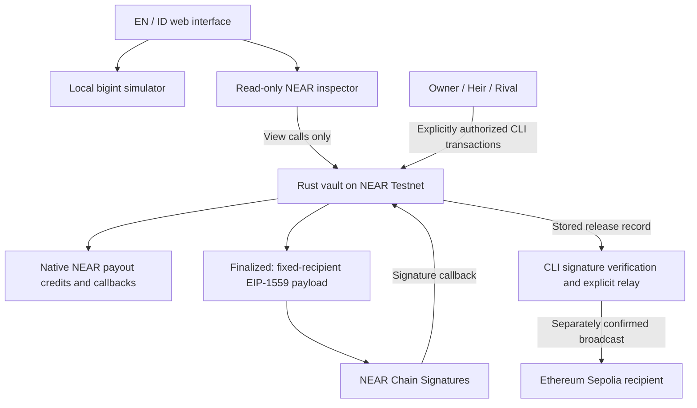

# Proof-of-Grudge

**An adversarial inheritance vault on NEAR, with destination-locked ETH releases on Ethereum Sepolia.**

Proof-of-Grudge explores a different role for an inheritance guardian: a rival who must put money behind a challenge. An heir stakes a bond after the owner misses a heartbeat. A rival can stake an equal bond to extend the claim window once. Only the owner's timely check-in cancels the claim; the rival cannot impose a free or indefinite veto.

Built for **NEAR Hackathon 2026**, targeting **Open Innovation (`open`)**. The MVP uses **NEAR Testnet** and **Ethereum Sepolia** only.

> **Development prototype — not audited or production-ready.** Contract, CLI and frontend source are implemented. End-to-end execution, contract tests and live-chain transfers have not been verified. The frontend is being redesigned; its current appearance is not the final demo.

[Mechanism](#how-it-works) · [Architecture](#architecture) · [Quick start](#quick-start) · [Verification](#verification) · [Security](#security-model-and-limitations) · [Disclosures](#libraries-templates-and-ai-disclosure)

## The problem

An inactivity-based vault must handle two conflicting risks: releasing assets while an owner is still alive but temporarily unavailable, and letting a guardian block a legitimate heir forever. A timer alone cannot distinguish those situations, while a cost-free guardian veto can become a source of griefing.

Proof-of-Grudge makes a challenge economically accountable. The rival buys the owner more time, but loses their bond if the owner does not return. The mechanism does **not** prove death, establish real-world identity, or guarantee rational behavior.

## Why NEAR

NEAR is the policy and accounting layer, not just a connection button:

- A Rust smart contract enforces role authorization, heartbeat deadlines, exact bond deposits and the four settlement branches.
- Native NEAR assets, locked bonds, available payout credits and transfers in flight are tracked separately.
- After inheritance is finalized, the vault constructs an EIP-1559 transaction and requests a signature through **NEAR Chain Signatures**.
- A separate CLI verifies the signature and can relay the transaction to **Ethereum Sepolia**, without an application-held EVM private key.

The browser is a local simulator and an optional read-only inspector. It does not hold keys, request wallet signatures or broadcast transactions. No AI model participates in authorization, settlement or the funds path. NEAR Intents, Bitcoin, custom tokens and multiple heirs are outside this MVP.

## How it works

### Roles

| Role | Responsibility |
| --- | --- |
| **Owner** | Checks in periodically; can withdraw accounted native NEAR assets while the vault is Idle. |
| **Heir** | Initiates a claim after a missed heartbeat by depositing exactly the required bond. |
| **Rival** | Challenges an active claim by depositing the same bond, extending the original deadline once. |

The three account IDs must be distinct and different from the vault account. The heir's 20-byte ETH recipient is fixed at initialization.

### Four payoff branches

Let **B** be the required bond and **A** the explicitly accounted native NEAR vault assets.

| Outcome | Rival challenged? | Owner checked in before the applicable deadline? | Vault assets | Bond settlement |
| --- | --- | --- | --- | --- |
| **False alarm** | No | Yes | Stay in the vault | B credited to Owner |
| **Busted** | Yes | Yes | Stay in the vault | 2B credited to Rival |
| **Uncontested** | No | No | A credited to Heir | B credited to Heir |
| **Spite backfired** | Yes | No | A credited to Heir | 2B credited to Heir |

**Credits are not completed transfers.** Each actor calls `withdraw_payout` separately. A matching failed-transfer callback restores the credit.

The contract has exactly four states: `Idle`, `Pending`, `Challenged` and `Finalized`. False alarm and Busted are outcomes, not additional states; both return the vault to Idle and reset its heartbeat. Finalized is terminal for claims and check-ins.

- Claim eligibility: `now > last_check_in + heartbeat_interval`.
- Owner check-in and rival challenge during a claim: `now < deadline`.
- Permissionless finalization: `now >= deadline`.
- At the exact deadline, check-in fails and finalization is allowed.

### Economic intuition

For a risk-neutral rival with subjective probability **p** that the owner returns before the extended deadline:

```text
EV(challenge) = pB - (1 - p)B = (2p - 1)B
```

The bond-sizing calculator also illustrates `B >= A(1 - q) / q`, where **q > 0** is an assumed owner-return probability and all assets are expressed in a common value unit. These are simplified models, not safety guarantees or financial advice. They omit gas, capital costs, collusion and uncertainty. The contract does not consume these probabilities or an AI estimate.

## Architecture



### Cross-chain release

1. Derive the ETH sender for the **vault account**, using the `ethereum-1` derivation path. This is not the heir's NEAR account or the recipient address.
2. Fund that derived address with a small amount of test-only Sepolia ETH.
3. Preview a transaction with fixed chain ID **11155111**, the initialized heir recipient, empty calldata and an empty access list.
4. After Finalized, Heir attaches the MPC deposit to `request_eth_release`. The vault requests signing from `v1.signer-prod.testnet` using the official interface's `domain_id: 0` and `payload_v2` schema.
5. The CLI independently checks the preimage/hash, validates and normalizes the signature, and requires its recovered sender to match the derived vault address.
6. Only an explicitly confirmed relay broadcasts to Sepolia. A stored signature alone is not proof of a broadcast or successful receipt.

The official MPC interface is pinned to source; compatibility with the deployed signer's current configuration, gas and required deposit still needs live verification. See the [contract documentation](contract/README.md) and [CLI workflow](scripts/README.md).

## Quick start

The steps below describe the intended reproducible workflow. **Expected results are not claims that every command has passed.** Frontend fixes remain in the local development working tree pending their own publication; local compilation results do not establish that the published checkout is fully validated.

### Prerequisites

| Tool | Development target | Needed for |
| --- | --- | --- |
| Node.js | 22.15.1 | Web, CLI and reference-vector tooling |
| npm | 11.6.2 recommended | Workspace dependency resolution |
| Rust / Cargo | 1.99.1 | Contract tests and WASM build |
| Rust target | `wasm32-unknown-unknown` | Contract WASM build |
| cargo-near | 0.23.0 | NEAR contract build |

Native Rust unit tests also require a working host linker/C++ toolchain. Trying the browser simulator does not require Rust, a wallet, NEAR accounts or RPC credentials.

### 1. Get the source and install dependencies

```sh
git clone https://github.com/StevBeq/Proof-Of-Grudge.git
cd Proof-Of-Grudge
npm exec --yes --package=npm@11.6.2 -- npm install
```

**Do this →** install the three npm workspaces: `contract/`, `scripts/` and `web/`. The temporary npm invocation does not replace your global npm. npm 10 encountered an internal `edgesOut` error during development; npm 11.6.2 completed dependency resolution on Node 22.15.1.

Installation requires internet. Retain and review the generated `package-lock.json`; once a reviewed lockfile is committed, use `npm ci` with the same npm version for clean installs. Cargo resolves its dependencies separately. Do not use `npm audit fix --force` as a substitute for reviewing compatibility and advisories.

### 2. Open the web simulator

```sh
npm run dev
```

**Do this →** open the local URL printed by Vite. English is the default; **EN / ID** changes the interface language and persists the preference. No private configuration is required for local simulation.

To explore the four branches:

1. Select **Local simulation** and advance past the heartbeat.
2. Act as **Heir** and initiate a claim.
3. Optionally switch to **Rival** and challenge.
4. Either switch to **Owner** and check in before the deadline, or advance past the deadline and finalize.
5. Inspect the state, outcome, bonds and credits. Claim a payout and simulate transfer success or failure.
6. Reset before trying another branch.

**Expected result →** the corresponding payoff appears without chain transactions. The demo uses a 120-second heartbeat, 60-second grace period, 60-second challenge extension, B = 1 NEAR and A = 10 NEAR. Values and transfers are simulated, not wallet balances or receipts.

Add `?renderer=svg` to the printed URL to use the SVG fallback. Reduced-motion users also receive the fallback. The scene is progressive enhancement, not a prerequisite for using the simulator.

Stop Vite with **Ctrl+C**.

### 3. Rehearse the CLI offline

```sh
npm run demo -- --dry-run
npm run demo -- --scenario busted
npm run demo -- --scenario inherit
npm run demo -- --scenario spite
npm run cli -- --help
```

**Do this →** inspect English call transcripts and settlement expectations. Omitting `--dry-run` still defaults to offline mode. Offline scenarios do not load credentials, query RPCs, sign transactions or write proof links. CLI fixtures use A = 5 NEAR and B = 1 NEAR, independently of the web fixture.

### 4. Generate the EIP-1559 reference fixture

```sh
npm run vectors
npm run vectors:check
```

**Do this →** generate `contract/vectors/eip1559.generated.json` using pinned viem serialization, then check it for deterministic agreement. Inputs cover zero nonce, zero value and large u128 values. The Rust golden test compares unsigned transaction bytes against this generated reference.

The fixture has **not yet been generated**. Its test intentionally fails with setup instructions if it is missing; reference bytes are not fabricated. See [vector provenance](contract/vectors/README.md).

### 5. Verify and build

```sh
npm run test:contract
npm run test:cli
npm run test:web
npm run typecheck
npm run build:contract
npm run build:web
```

**Do this →** run the authored suites, check TypeScript, and build the WASM contract and web application. Generate the reference fixture first. `npm test` checks the fixture before running all three suites.

The contract build wraps `cargo near build non-reproducible-wasm`. Measure WASM size only after a successful build. Direct `testing_env!` method calls do not prove extern-wrapper authorization, receipt rollback, actual callback delivery, gas sufficiency or storage behavior; those require additional Sandbox and testnet validation.

## Live setup and execution boundaries

No deployment or transaction is performed by the quick-start steps above.

Before live execution, create and fund distinct human-controlled Owner, Heir and Rival testnet accounts, select the real heir ETH recipient, and create a clean vault account. Initialization must lock the correct accounts, destination, bond and timers. No operational identities or deployment addresses are invented in this repository.

- **Web configuration:** `web/.env.example` documents public settings. `VITE_VAULT_CONTRACT_ID` identifies the actual deployed testnet vault. All `VITE_*` values are browser-visible; never place keys or secrets there.
- **Live inspector:** reads `get_vault_state`, retains the last successful snapshot on failure, and identifies stale data. Without a configured vault, it shows setup instructions rather than fabricated balances.
- **CLI configuration:** `scripts/.env.example` documents inputs. The CLI consumes inherited process environment and does not automatically load `.env` files. Never pass private keys as CLI arguments or publish them in logs.
- **Read-only access:** requires `--read-only --confirm-testnet`.
- **NEAR writes:** require `--execute --confirm-testnet`.
- **Sepolia broadcast:** additionally requires `--broadcast --confirm-sepolia`.
- **Deployment:** account creation, deploy/init and FullAccess-key removal are not automated by the application CLI. Final deploy and init must be batched before any separately reviewed, explicitly authorized key removal.

Different finalized inheritance scenarios require separate fresh vaults. A preflight deadline check cannot guarantee timely chain inclusion. Follow the [CLI documentation](scripts/README.md) for exact commands and funding requirements before authorizing any live action.

## Verification

| Area | Current evidence |
| --- | --- |
| Frontend TypeScript and production compilation | Passed in the local development working tree; not a clean-checkout or browser-interaction guarantee. |
| Vite source transforms | 22 non-test source files transformed in a bounded local check. A separate HTTP check returned 200 for key routes but timed out during shutdown. |
| Automated Rust, CLI and web suites | Authored; not yet executed. |
| viem golden fixture | Generator and inputs provided; output and byte-for-byte verification pending. |
| Contract WASM, storage and gas | Not yet verified. |
| Sandbox callbacks and live MPC compatibility | Not yet verified. |
| NEAR/Sepolia deployment and transaction receipts | Not available. |
| Hosted demo, final UI screenshots and demo video | Pending. |

The most recent local dependency audit reported **13 findings: 11 low, 1 moderate and 1 high; zero critical**. The moderate/high chain involves the vector workspace's pinned viem dependency and transitive `ws`. Audit results are time- and lockfile-dependent; re-run and review them before deployment. The build also reported a Node `util` externalization warning in the dynamic NEAR SDK graph and a Three.js chunk over 500 kB. Neither browser runtime compatibility nor performance is established by a successful build alone.

`web/public/proofs.json` starts empty with `verified:false`. Explicit CLI `--write-proofs` can later record observed explorer links; these are not independent consensus or finality proofs. No successful live transfer is claimed here.

## Security model and limitations

### Implemented safeguards

- **Predecessor-based authorization:** actor checks use `predecessor_account_id`, not the transaction signer.
- **Explicit accounting:** `vault_assets` includes only admitted `deposit_vault` deposits. Bonds use separate fields. Raw account balance is a solvency guard, never a payout formula.
- **Checked arithmetic:** timestamps and monetary additions are bounded; claim and challenge deposits must equal B exactly.
- **Pull payments:** native payouts use per-actor pending slots and private callbacks that restore failed-transfer credit. Idle Owner withdrawal creates credit before a separate payout request.
- **Fixed ETH destination:** callers cannot change the recipient, Sepolia chain, derivation path, calldata or access list.
- **MPC failure reserve:** signing requires additional unallocated surplus equal to the forwarded deposit, beyond storage, liabilities and a 1 NEAR operating buffer. Failure credit does not assume MPC returns a consumed deposit. New signing is blocked while any native payout remains unresolved.
- **No administrative bypass:** no pause, admin override or application-level upgrade entry point. Removing account FullAccess keys is a separate, irreversible operational step; the absence of an upgrade method alone does not make a key-controlled account immutable.

### Known risks

1. **Inactivity is not death.** A living owner can miss both windows and lose access to the inheritance assets.
2. **Accounts are not people.** An heir and rival controlled by one person defeat the intended independence. Bond size cannot eliminate collusion.
3. **Keys can be lost or compromised.** There is no administrative recovery. A compromised owner authorization key can keep the heartbeat alive.
4. **Callbacks can fail.** Insufficient gas or storage can leave a transfer/signature unresolved. Unit mocks are not proof of runtime recovery.
5. **Cross-chain execution is not atomic.** NEAR cannot validate Sepolia balance, nonce, fees, mempool inclusion or receipts.
6. **Signatures cannot be revoked.** Replacing a stored signature does not invalidate an earlier one. Different-nonce transactions may both execute if funded, always to the locked recipient.
7. **Owner's escape hatch is NEAR-only.** ETH at the derived sender is releasable only after finalization in this MVP. Do not use this prototype for production custody.

See [contract invariants and MPC details](contract/README.md) for the accounting and callback design.

## Repository structure

```text
contract/          Rust vault, MPC integration, EIP-1559 encoder and tests
contract/vectors/  viem fixture inputs, generator and provenance
scripts/           Offline rehearsal, gated live commands and Sepolia relay
web/               English/Indonesian simulator and read-only inspector
test-vectors/      Shared payoff and deadline scenarios
LICENSE            MIT license
```

## Libraries, templates and AI disclosure

The following disclosure documents reused components and AI assistance for hackathon rule **Q-005**. It does not imply that AI-generated code has been audited.

| Area | Libraries or source |
| --- | --- |
| Contract | near-sdk 5.30.1; official `near-mpc-contract-interface` pinned to `near/mpc` commit `d0fc87b19e2643299e7becdd7d9611afcd5d5a78`. |
| Contract scaffold | Manifest/release profile adapted from cargo-near 0.23.0's official embedded template. Automatic nested Git initialization, initial commit and deployment workflows were omitted; deviations and source links are in the contract README. |
| CLI | TypeScript, tsx, near-api-js, viem, `@noble/curves`, bs58 and Node standard library. |
| Web | React, React DOM, Vite, TypeScript, Tailwind CSS, vanilla Three.js, GSAP, Lenis, Phosphor Icons and near-api-js. |
| Typography | Self-hosted Fontsource Big Shoulders Display, Instrument Sans and IBM Plex Mono. |
| Verification tooling | Rust/near-sdk native test utilities, Vitest, Node's test runner and viem reference serialization. |

Exact direct versions are specified in the workspace manifests. Reference vectors intentionally use viem **2.38.5**, while the CLI uses **2.57.16**; changing the reference version requires a provenance review rather than silent substitution.

**AI assistance:** Claude and Gemini assisted earlier planning and architecture. OpenAI GPT-6.1 Sol in Zed, delegated coding agents, the Impeccable design skill, and NEAR Docs MCP/public-source retrieval assisted implementation, authored tests, documentation and frontend troubleshooting. Proposed future redesign model assignments are not completed implementation work. Human review and independent validation remain necessary.

**Assets:** the current scene uses procedural geometry/SVG. No stock imagery, generated image service, AI inference backend, privacy/TEE attestation or AI-controlled settlement is included. UI redesign references are inspiration, not third-party assets or code incorporated into this implementation.

## Hackathon readiness

The [live NEAR Hackathon rules](https://nearhackathon.com/HACKATHON.md) require a public repository and reproducible documentation; testnet-only projects are eligible. The published development deadline is **14 November 2026, 23:59 UTC**. Re-check the live rules before submission.

Remaining release work:

- [ ] Review dependency advisories and publish reviewed dependency/source fixes.
- [ ] Generate reference vectors; pass the authored tests, contract build and Sandbox checks.
- [ ] Complete the UI redesign and desktop/mobile accessibility review.
- [ ] Verify the live MPC integration and record successful Testnet/Sepolia receipt evidence.
- [ ] Add the final demo link, screenshots and a real demo video. Local-only demonstrations require video for reproducibility review.
- [ ] Have the human publish the public X demo post identifying NEAR Hackathon and tagging `@NEARProtocol` and `#NEARHackathon`.
- [ ] Confirm a human-created NEAR Mainnet prize-payout account and all submission details.

Publishing this README is not a competition submission. Submission requires separate approval of the exact payload and must occur only once per project; corrections use the organizers' request-changes process.

## License

[MIT](LICENSE).
