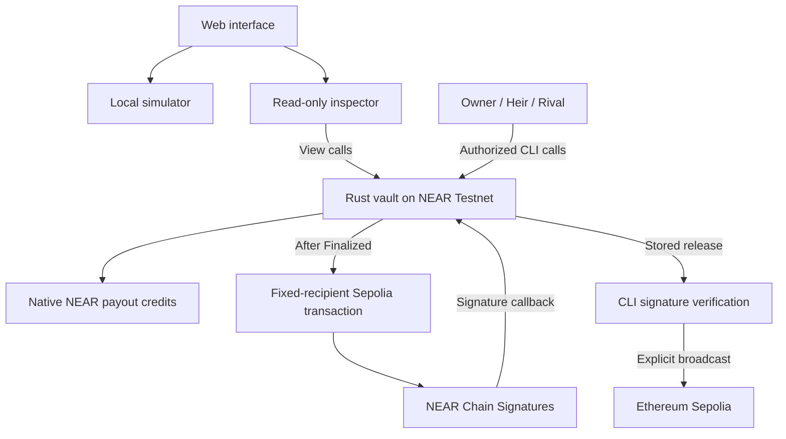

# Proof-of-Grudge

An adversarial inheritance vault on **NEAR Testnet**, with destination-locked ETH releases on **Ethereum Sepolia** through NEAR Chain Signatures.

Built for **NEAR Hackathon 2026 · Open Innovation (`open`)**.

## What this is

A four-part plain-language summary:

**The problem.** An inheritance vault that releases funds after owner inactivity cannot tell *"the owner is on holiday"* from *"the owner has died"*. A naive guardian can then block a legitimate heir forever, or release the estate while the owner still lives.

**The product.** A NEAR smart contract that holds the vault and enforces a contested claim. After the owner misses their heartbeat, a **heir** stakes a bond to claim. A **rival** may stake an equal bond to force a deadline extension — once. Only the owner's timely check-in cancels a claim, and a rival who loses pays the heir double. Settlement is a pull-payment ledger on NEAR; the vault never trusts raw account balances.

**The cross-chain step.** After inheritance is finalized, the contract itself builds an EIP-1559 transaction to the pre-registered heir ETH address and requests a signature from **NEAR Chain Signatures (MPC)**. The CLI verifies that signature and relays the transaction to Ethereum Sepolia. No application-held EVM private key exists at any point.

**What is in the repository.**

- `contract/` — the Rust vault contract (deadlines, authorization, accounting, MPC request) on NEAR Testnet.
- `scripts/` — an offline CLI: reproducible scenarios for all four outcomes plus gated, explicitly-authorized Testnet/Sepolia operations.
- `web/` — an English/Indonesian web simulator with an optional read-only inspector of the live contract.

The fastest non-browser check is the four `npm run demo -- --dry-run` commands under [Run locally](#run-locally); the fastest visual check is the web simulator via `npm run dev`.

**Status:** development prototype, not audited. Local tests pass (41 Rust unit tests, 1 viem golden-vector test, 33 CLI/setup tests and 33 web tests), and the WASM builds with embedded ABI. All four native NEAR payoff branches have executed on Testnet with successful payout receipts. Cross-chain ETH release on Ethereum Sepolia has been successfully signed via NEAR Chain Signatures MPC and broadcast. See [Testnet evidence and setup](scripts/TESTNET.md).

### Live NEAR Testnet Evidence

The contract is actively deployed on NEAR Testnet and verified across all four payoff branches:

| Entity / Action | Identifier / Explorer Link |
| --- | --- |
| **Deployed Vault** | [`pog-mw835qrr-1c82b2-vault.testnet`](https://testnet.nearblocks.io/address/pog-mw835qrr-1c82b2-vault.testnet) |
| **Deploy & Init Tx** | [AkyXh4z9HBYNSYezLWg8cvj8WQLyt5xawZj7UAqNy57B](https://testnet.nearblocks.io/txns/AkyXh4z9HBYNSYezLWg8cvj8WQLyt5xawZj7UAqNy57B) |
| **Heir Payout (7 NEAR)** | [5Mdjx8gRtCoDvzaH4tukgpCdrhPr5qACw2enupU2DfSQ](https://testnet.nearblocks.io/txns/5Mdjx8gRtCoDvzaH4tukgpCdrhPr5qACw2enupU2DfSQ) |
| **Rival Payout (2 NEAR)** | [ANGSds3oyHiqdFW5ZQLCDzAwRsLaUKBbD9EuYdnAcfBh](https://testnet.nearblocks.io/txns/ANGSds3oyHiqdFW5ZQLCDzAwRsLaUKBbD9EuYdnAcfBh) |
| **Owner Payout (1 NEAR)** | [2BXG1iSt7m16wtd1gjfDezRZkQAzQ4Gk6XgmJsuss7WL](https://testnet.nearblocks.io/txns/2BXG1iSt7m16wtd1gjfDezRZkQAzQ4Gk6XgmJsuss7WL) |
| **MPC Sign Request (NEAR)** | [3YjwuYyEAAVxLKt8mJqkchnXvPdYVnkBAjACsCFYbTDu](https://testnet.nearblocks.io/txns/3YjwuYyEAAVxLKt8mJqkchnXvPdYVnkBAjACsCFYbTDu) |
| **Sepolia ETH Release (EVM)** | [0xc703affa31096138523f3f7ce40a442552ab08d41ff63e9b756ce479da5af758](https://sepolia.etherscan.io/tx/0xc703affa31096138523f3f7ce40a442552ab08d41ff63e9b756ce479da5af758) |

## How NEAR is used

NEAR is the enforcement layer. The contract decides when a claim can start, whether a challenge or check-in is timely, and which actor receives each payout credit.

After inheritance is finalized, the contract constructs an EIP-1559 transaction with the initialized heir's ETH recipient and requests a signature from the NEAR Testnet MPC contract. The CLI verifies the returned signature and can relay the signed transaction to Ethereum Sepolia. It does not require an application-held EVM private key.



The browser never signs or broadcasts. No AI model controls authorization or funds. The MVP does not use NEAR Intents, Bitcoin, custom tokens or multiple heirs.

## Mechanism

**Owner** checks in periodically. **Heir** claims after the heartbeat expires. **Rival** can challenge once by staking the same bond. All three accounts must be distinct.

Let **B** be the bond and **A** the explicitly accounted native NEAR vault assets.

| Outcome | Rival challenges | Owner returns before deadline | Vault assets | Bond credit |
| --- | --- | --- | --- | --- |
| False alarm | No | Yes | Remain in vault | B to Owner |
| Busted | Yes | Yes | Remain in vault | 2B to Rival |
| Uncontested | No | No | A to Heir credit | B to Heir |
| Spite backfired | Yes | No | A to Heir credit | 2B to Heir |

States are `Idle`, `Pending`, `Challenged` and `Finalized`. False alarm and Busted return the vault to Idle and reset its heartbeat. Finalized is terminal for claims and check-ins.

- A claim requires `now > last_check_in + heartbeat_interval`.
- An active-claim check-in or challenge requires `now < deadline`.
- Anyone may finalize at `now >= deadline`.
- At the exact deadline, check-in is rejected and finalization is allowed.

Settlement creates **withdrawable credits**, not completed transfers. Each actor separately calls `withdraw_payout`; a matching failed-transfer callback restores the credit. Owner can move accounted native NEAR assets into their credit only while Idle.

## Run locally

All commands below start from the repository root unless stated otherwise. Expected results describe what to inspect; they are not passing-test claims.

### Prerequisites

| Tool | Version | Required for |
| --- | --- | --- |
| Node.js | 22.15.1 | Web, CLI and vector generator |
| npm | 11.6.2 recommended | Workspace installation |
| Rust / Cargo | 1.99.1 | Contract tests and build |
| Rust target | `wasm32-unknown-unknown` | WASM compilation |
| cargo-near | 0.23.0 | Contract build |

Native Rust tests also need a working host linker/C++ toolchain and, on Windows x86-64, NASM for the cryptography dependencies. **The offline CLI and web simulator need no wallet, account, API key or deployed contract.** Initial package installation requires internet; the simulator and CLI scenarios do not require chain access afterward.

### 1. Install dependencies

```sh
git clone https://github.com/StevBeq/Proof-Of-Grudge.git
cd Proof-Of-Grudge
npm exec --yes --package=npm@11.6.2 -- npm install
```

**Expected result:** npm installs the `contract`, `scripts` and `web` workspaces. The temporary npm invocation does not replace global npm. Retain the generated lockfile; use `npm ci` with the same npm version when a reviewed `package-lock.json` is available in the checkout. Cargo dependencies are resolved separately.

### 2. Verify the four branches without a browser

```sh
npm run demo -- --dry-run --scenario false-alarm
npm run demo -- --dry-run --scenario busted
npm run demo -- --dry-run --scenario inherit
npm run demo -- --dry-run --scenario spite
```

**Expected result:** each command exits successfully and prints a JSON transcript marked `Simulated: off-chain state machine`, with `network_requests: 0`, `signed: false` and `proofs_written: false`. These scenarios use an injected clock; no real heartbeat waiting is required.

The CLI fixture starts with **A = 5 NEAR** and **B = 1 NEAR**. Inspect these fields in each result:

| Scenario | `state.state.status` | `state.last_outcome` | `recipient` | `new_credit_yocto` |
| --- | --- | --- | --- | --- |
| `false-alarm` | `Idle` | `FalseAlarm` | `owner` | `1000000000000000000000000` |
| `busted` | `Idle` | `Busted` | `rival` | `2000000000000000000000000` |
| `inherit` | `Finalized` | `Uncontested` | `heir` | `6000000000000000000000000` |
| `spite` | `Finalized` | `SpiteBackfired` | `heir` | `7000000000000000000000000` |

Each scenario also performs a simulated payout. The recipient's final credit is zero; `transferred_yocto` records the simulated amount. This is not evidence of an on-chain transfer.

To inspect the command interface:

```sh
npm run cli -- --help
```

### 3. Open the web simulator

```sh
npm run dev
```

**Expected result:** Vite prints a local URL. Open that URL and select **Local simulation**. English is the default; **EN / ID** switches the interface language.

For a complete contested claim:

1. Click **To deadline** to advance past the missed heartbeat.
2. Select **Heir**, then **Initiate claim**.
3. Select **Rival**, then **Challenge claim**.
4. Click **To deadline**, then **Finalize vault**.
5. Observe `Finalized`, the Spite backfired outcome, and Heir's credit of **12 NEAR**.
6. As Heir, click **Claim payout**, then **Simulate transfer failure**. Observe that the credit is restored.

The browser fixture uses **A = 10 NEAR**, **B = 1 NEAR**, a 120-second heartbeat, 60-second grace and a 60-second challenge extension. Reset the simulation before trying another branch. All displayed actions in this mode are off-chain.

Append `?renderer=svg` to the printed URL for the non-WebGL fallback. Stop Vite with **Ctrl+C**. The **Live inspector** is optional and requires a real deployed contract; it is not required for local evaluation.

## Tests and builds

Generate the reference fixture **before** running the test suites:

```sh
npm run vectors
npm run vectors:check
npm test
npm run typecheck
npm run build:contract
npm run build:web
```

| Command | Expected result |
| --- | --- |
| `npm run vectors` | Writes `contract/vectors/eip1559.generated.json` using pinned viem serialization. |
| `npm run vectors:check` | Confirms the generated file matches the current inputs and serializer. |
| `npm test` | Checks the fixture, then runs Rust, CLI and web test suites; exits nonzero on failure. |
| `npm run typecheck` | Checks both CLI and web TypeScript without emitting application code. |
| `npm run build:contract` | Builds the NEAR WASM through cargo-near. |
| `npm run build:web` | Builds the web application into `web/dist/`. |

Individual suites are available as `npm run test:contract`, `npm run test:cli` and `npm run test:web`. The Rust command is `cargo test --manifest-path contract/Cargo.toml -- --nocapture`.

Authored coverage includes the four payoff branches, exact deadlines, role checks, bond accounting, transfer/signature callback mocks, shared Rust/TypeScript scenarios, and EIP-1559 byte comparison against viem. The golden-vector inputs cover zero nonce, zero value and large u128 amounts. A missing reference file is a test failure, not a skipped test. See [vector provenance](contract/vectors/README.md).

**Observed validation:** the suites above and TypeScript checks pass locally. The optimized WASM is 196,109 bytes with SHA-256 `f254791a926540c2f4991387a72b35ba97120fed5cb57fdd80505318084b9592`; both Testnet deployments use this code hash. The build wrapper enables `near-sdk/unit-testing` only for native ABI generation, not for the on-chain WASM, and preserves ABI embedding. On Windows it can use the optional official portable NASM installation in `.rtk/tools/nasm-3.02`, otherwise NASM must be on PATH.

A separate empty workspace installation using the generated lockfile and npm 11.6.2 completed with `npm ci`. This checks locked installation, not a full clean-clone build/test run.

**Validation boundary:** clean-clone reproduction, Sandbox fault injection and live MPC/Sepolia execution remain unverified. Sandbox requires Linux or supported macOS; it was not run on this Windows host. Testnet payoff receipts establish the tested native transfers and callbacks, not every failure path or production gas/storage guarantee.

## Optional live integration

Live execution requires a separately deployed and initialized vault, distinct funded NEAR Testnet actors, the chosen heir ETH address, and Sepolia test ETH at the vault-derived sender. No deployment is created by the local evaluation commands.

- **Browser:** configure the public `VITE_VAULT_CONTRACT_ID` and trusted RPC URLs described in `web/.env.example`. Never put secrets in `VITE_*`; they are exposed to the browser.
- **CLI:** configuration names are documented in `scripts/.env.example`. The regular CLI uses the inherited process environment and does not automatically load `.env` files. The separate `npm run testnet:local` setup wrapper creates dedicated test keys and loads its own ignored local configuration only when explicitly requested; see [setup instructions](scripts/TESTNET.md).
- **Views:** require `--read-only --confirm-testnet`.
- **NEAR writes:** require `--execute --confirm-testnet`.
- **Sepolia broadcast:** additionally requires `--broadcast --confirm-sepolia`.

The release workflow is **derive → fund → preview → request → verify → relay**. The derived ETH sender belongs to the vault's derivation path, not the heir's NEAR account. Transactions are locked to Sepolia chain **11155111**, the initialized recipient, empty calldata and an empty access list. A returned signature is not proof of a successful Ethereum transaction.

The MPC request uses the official interface's `domain_id: 0`, `payload_v2` and `ethereum-1` path against `v1.signer-prod.testnet`. Read-only Testnet calls confirmed its Running state, domain-0 Secp256k1 key and configuration; successful signing with the pinned interface and deposit is still unverified. Full setup and commands are in the [CLI guide](scripts/README.md); the [contract guide](contract/README.md) explains the request format and accounting.

## Security and limitations

- **Explicit ledgers:** vault assets, heir/rival bonds, credits and in-flight payouts are separate. Raw account balance is not the payout formula.
- **Authorization and deadlines:** role checks use the predecessor account; arithmetic is checked and deposits must match the bond exactly.
- **Failure handling:** native payouts use private callbacks. MPC failure credits require additional operating surplus equal to the signing deposit, separate from storage and the 1 NEAR operating buffer. New signing is blocked while any native payout is unresolved.
- **No administrative bypass:** no pause or admin override. FullAccess-key removal is a separate operational step; an account with deployment keys is not immutable merely because the contract has no upgrade method.
- **Inactivity is not death:** a living owner can miss both windows. Distinct account IDs do not prove independent people; heir/rival collusion and undersized bonds remain risks.
- **Cross-chain limits:** NEAR cannot check Sepolia balance, nonce, fees or receipts. Previously issued signatures cannot be revoked by replacing the stored release.
- **Recovery limits:** lost keys or failed callbacks can leave funds inaccessible. Owner withdrawal is NEAR-only; this MVP has no living-owner ETH exit.

This prototype is not intended for production custody. Dependency security review, independent contract review and live verification remain outstanding.

## Repository structure

```text
contract/          Rust vault, MPC integration, EIP-1559 encoder and tests
contract/vectors/  viem reference inputs, generator and provenance
scripts/           Offline scenarios and gated live CLI/relay
web/               EN/ID simulator and read-only inspector
test-vectors/      Shared payoff and deadline scenarios
```

## Libraries, templates and AI assistance

Disclosed for [NEAR Hackathon rule Q-005](https://nearhackathon.com/HACKATHON.md):

- **Contract:** near-sdk; official `near-mpc-contract-interface` from `near/mpc`, pinned to commit `d0fc87b19e2643299e7becdd7d9611afcd5d5a78`.
- **Template:** contract manifest/release profile adapted from the official cargo-near 0.23.0 template. Source links and deviations are documented in the contract guide.
- **CLI:** TypeScript, tsx, near-api-js, viem, `@noble/curves`, bs58 and Node standard library.
- **Web:** React/React DOM, Vite, TypeScript, Tailwind CSS, Three.js, GSAP, Lenis, Phosphor Icons and near-api-js.
- **Fonts:** Fontsource Big Shoulders Display, Instrument Sans and IBM Plex Mono. Scene assets are procedural geometry/SVG.
- **Testing:** near-sdk test utilities, Vitest, Node's test runner and viem. Reference serialization uses viem 2.38.5; CLI serialization uses 2.57.16. Direct dependency versions are recorded in the workspace manifests.
- **AI tools:** OpenAI tools in Zed, Claude and Gemini assisted planning, implementation or documentation. Impeccable provided design guidance; NEAR Docs MCP supported documentation research. AI-generated contributions require independent review. No AI model participates in settlement.

## License

[MIT](LICENSE).
