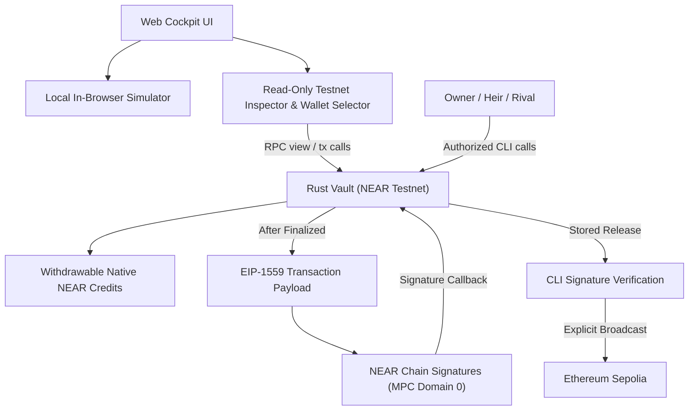

<div align="center">

# Proof-of-Grudge


### An adversarial dead-man's switch on NEAR Testnet, with destination-locked ETH releases on Ethereum Sepolia through NEAR Chain Signatures.

*Don't trust saints. Arm their rival.*

<p align="center">
  <a href="https://proof-of-grudge.vercel.app"></a>
  <a href="https://nearhackathon.com"></a>
  <a href="https://github.com/StevBeq/Proof-Of-Grudge/actions/workflows/ci.yml"></a>
  <a href="https://github.com/StevBeq/Proof-Of-Grudge"></a>
  <a href="https://github.com/StevBeq/Proof-Of-Grudge"></a>
  <a href="https://github.com/StevBeq/Proof-Of-Grudge"></a>
  <a href="https://testnet.nearblocks.io/address/pog-mw835qrr-1c82b2-vault.testnet"></a>
  <a href="LICENSE"></a>
</p>

[Live Web App](https://proof-of-grudge.vercel.app) · [For Judges (Quick Verification)](#for-judges-quick-verification) · [Live Testnet Evidence](#live-near-testnet--sepolia-evidence) · [Security Policy](SECURITY.md) · *Video Demo on X: pending final recording*

</div>

---

## For Judges: Quick Verification

Inspect Proof-of-Grudge from zero-install read-only RPC checks up to a full cross-platform build:

1. **Browser, no wallet, nothing to install (~30s):** Open **[https://proof-of-grudge.vercel.app](https://proof-of-grudge.vercel.app)**. Switch between the **Local Simulator** (step through all 4 game-theoretic payoff branches and BondLab formula $B \ge A \times (1 - q) / q$) and **Live Testnet Inspector** (read-only view of [`pog-mw835qrr-1c82b2-vault.testnet`](https://testnet.nearblocks.io/address/pog-mw835qrr-1c82b2-vault.testnet)). Optional Testnet wallet connection lets any visitor create and interact with a fresh vault.
2. **Terminal, read-only public RPC, no clone (~10s):** Verify `0` access keys (`"keys":[]`), on-chain WASM `code_hash`, and settled `Finalized / SpiteBackfired` state directly from fastnear RPC:
   ```bash
   # Check zero remaining access keys
   curl -s https://test.rpc.fastnear.com -H 'Content-Type: application/json' \
     -d '{"jsonrpc":"2.0","id":1,"method":"query","params":{"request_type":"view_access_key_list","finality":"final","account_id":"pog-mw835qrr-1c82b2-vault.testnet"}}'

   # Inspect deployed contract code_hash
   curl -s https://test.rpc.fastnear.com -H 'Content-Type: application/json' \
     -d '{"jsonrpc":"2.0","id":1,"method":"query","params":{"request_type":"view_account","finality":"final","account_id":"pog-mw835qrr-1c82b2-vault.testnet"}}'

   # Inspect settled vault state (Finalized / SpiteBackfired)
   curl -s https://test.rpc.fastnear.com -H 'Content-Type: application/json' \
     -d '{"jsonrpc":"2.0","id":1,"method":"query","params":{"request_type":"call_function","finality":"final","account_id":"pog-mw835qrr-1c82b2-vault.testnet","method_name":"get_vault_state","args_base64":"e30="}}'
   ```
3. **Offline CLI State Machine, cross-shell (Node >= 22.15.1):** Works identically in **PowerShell 7, `cmd.exe`, Git Bash, bash, and zsh**:
   ```bash
   git clone https://github.com/StevBeq/Proof-Of-Grudge.git && cd Proof-Of-Grudge && npm install
   npx tsx scripts/run-demo.ts --dry-run --scenario spite
   ```
   Prints structured JSON (`Simulated: off-chain state machine`, `network_requests: 0`, `status: Finalized`, `last_outcome: SpiteBackfired`, `Heir` credited `7 NEAR`).
4. **Full Build & Test Suite (`108` test cases + `vectors:check`):** After installing the prerequisites listed below, run `npm test && npm run typecheck && npm run build`.

---

## How Proof-of-Grudge Meets NEAR Hackathon Criteria

| Criterion | What Proof-of-Grudge Delivers | Where to Inspect |
| :--- | :--- | :--- |
| **Technical Implementation** | Rust smart contract (`near-sdk 5.30.1`), official `near-mpc-contract-interface` (`payload_v2`, `domain_id: 0`), EIP-1559 RLP encoder cross-verified byte-for-byte against `viem 2.57.19`, pull-payment ledger with operating-surplus reserve, green CI (`ubuntu-latest`), 42 contract + 33 CLI + 33 web tests. | [`contract/src/lib.rs`](contract/src/lib.rs), [`contract/tests/rlp_golden.rs`](contract/tests/rlp_golden.rs), [`.github/workflows/ci.yml`](.github/workflows/ci.yml) |
| **Design & Comprehension** | Bilingual (`EN` / `ID`) interactive web dossier with procedural cel-shaded Three.js vault centerpiece synchronized with real contract transitions, interactive BondLab economic calculator, and reduced-motion/SVG support. | [`web/src/scene/monolith.ts`](web/src/scene/monolith.ts), [`web/src/sections/Cockpit.tsx`](web/src/sections/Cockpit.tsx) |
| **Game-Theoretic Impact** | Replaces trusted trustees and multi-sig committees with an adversarial tri-actor mechanism (`Owner`, `Heir`, `Rival`) and symmetrical bonds sized by $B \ge A \times (1 - q) / q$ so false-claim griefing yields negative expected value when $q > 0$. | [`README.md#mechanism--payoff-matrix`](#mechanism--payoff-matrix), [`web/src/lib/vaultSimulator.ts`](web/src/lib/vaultSimulator.ts) |
| **Originality** | "No Free Veto": an objector (`Rival`) must stake an identical bond $B$ to contest a claim—if the `Owner` checks in before the extended deadline, the Rival captures `2B` funded by the false claimant. Settlement across NEAR and Ethereum Sepolia requires zero custodial EVM private keys. | [`contract/src/mpc.rs`](contract/src/mpc.rs), [`contract/src/eth_rlp.rs`](contract/src/eth_rlp.rs) |
| **Security & Honesty** | Explicit threat table, predecessor-only auth, `keys: []` verified live via separate `DeleteKey` tx after batch `DeployContract + init`, and transparent scope limits. | [`SECURITY.md`](SECURITY.md), [`scripts/TESTNET.md`](scripts/TESTNET.md) |

---

## The Story: An Inheritance with Opposition

### 01 · Three People. One Case File.

An inheritance vault cannot tell *"on holiday"* apart from *"deceased"*. Proof-of-Grudge splits custody across **Owner** (keeper), **Heir** (claimant), and **Rival** (objector)—opening the claim window only when periodic `check_in()` heartbeats expire.


---

### 02 · Symmetrical Bonds: Arming the Rival

After a missed heartbeat, the **Heir** locks **Bond B (`1 NEAR`)** to initiate a claim, and any **Rival** can contest with an equal **Bond B (`1 NEAR`)**. If the Owner checks in before the extended deadline, the Rival wins **`2B` (`100%` net profit)** funded by the false claimant.


---

### 03 · Size the Bond, Not the Story

Proof-of-Grudge calibrates bond **B** from vault principal **A** and return probability **q** using $B \ge A \times (1 - q) / q$, ensuring false-claim griefing yields negative expected value whenever $q > 0$.


---

### 04 · Zero Keys & Autonomous Sepolia MPC Release

Once finalized, the NEAR contract constructs an EIP-1559 payload locked to the initialized Heir EVM address and requests a threshold signature from **NEAR Chain Signatures (`MPC Domain 0`)**. Deployed via atomic `DeployContract + init` (`AkyXh4z9...`) followed by `DeleteKey` (`8itgVeVs...`), leaving `"keys": []` on-chain.


---

## Machine-Reproducible Verification ("Do → See")

### Required Build & Test Prerequisites

- **Node.js `>= 22.15.1`** (`npm >= 10`) — runs workspaces, `viem` RLP golden vectors, CLI dry-run/tests, and Vite web app.
- **Rust `>= 1.95`** + WASM target (`rustup target add wasm32-unknown-unknown`) — compiles contract tests and WASM target.
- **`cargo-near` `v0.23.0`** — required for `npm run build` / `npm run build:contract` (`cargo near build non-reproducible-wasm`). Install prebuilt binaries from [cargo-near v0.23.0 releases](https://github.com/near/cargo-near/releases/tag/cargo-near-v0.23.0) or via `cargo install cargo-near --version 0.23.0 --locked`.
- **Native Crypto Tools (`aws-lc-sys`):** On **Windows**, install **NASM** (or place official portable `nasm.exe` in `.rtk/tools/nasm-3.02/`, which `scripts/rust-toolchain.mjs` prepends automatically) plus MSVC C/C++ Build Tools. On **Linux/macOS**, install `nasm` and standard C toolchain (`gcc`/`clang`).

| Do | See |
| :--- | :--- |
| **Clone & install**<br>`git clone https://github.com/StevBeq/Proof-Of-Grudge.git && cd Proof-Of-Grudge && npm install` | Workspaces (`contract`, `scripts`, `web`) resolve cleanly against `package-lock.json`; `npm audit --audit-level=moderate` exits `0` (`0` moderate/high/critical advisories). |
| **Verify RLP golden vectors**<br>`npm run vectors:check` | Prints `eip1559.generated.json matches pinned viem serialization` (LF-normalized cross-platform via `.gitattributes`). |
| **Run all test suites**<br>`npm test` | Runs `vectors:check` parity gate plus **108 test cases** (42 contract: 41 unit + 1 RLP golden vector, 33 CLI, 33 web). |
| **Run Rust contract suite directly**<br>`cargo test --manifest-path contract/Cargo.toml` | `42 passed` (41 unit + 1 golden vector matching `viem 2.57.19` byte-for-byte). *(Line-coverage tooling is not configured.)* |
| **Build contract WASM + Web UI**<br>`npm run build` | Builds `contract/target/near/proof_of_grudge.wasm` (196,109 bytes with embedded ABI) and `web/dist/` production bundle. |
| **Run offline CLI dry-run (all shells)**<br>`npx tsx scripts/run-demo.ts --dry-run --scenario spite` | Formatted JSON (`Simulated: off-chain state machine`, `network_requests: 0`, `Finalized`, `SpiteBackfired`, `Heir` credited `7 NEAR`). Also works via `npm run demo -- --dry-run --scenario spite` in `cmd.exe`/POSIX shells. |
| **Inspect zero access keys live**<br>`node -e "fetch('https://test.rpc.fastnear.com',{method:'POST',headers:{'Content-Type':'application/json'},body:JSON.stringify({jsonrpc:'2.0',id:1,method:'query',params:{request_type:'view_access_key_list',finality:'final',account_id:'pog-mw835qrr-1c82b2-vault.testnet'}})}).then(r=>r.json()).then(j=>console.log(j.result.keys))"` | Prints `[]`. Zero `FullAccess` keys exist on the deployed vault account. |
| **Launch Web Simulator**<br>`npm run dev` (or visit [proof-of-grudge.vercel.app](https://proof-of-grudge.vercel.app)) | Interactive cel-shaded 3D strongbox loads with bilingual support (`EN` / `ID`). |
| **Advance time & claim in Web**<br>Click **To deadline** &rarr; Select **Heir** &rarr; Click **Initiate claim** | Status shifts to `Pending`, Heir's 1 NEAR bond locks, and the challenge window begins. |
| **Simulate Rival challenge**<br>Select **Rival** &rarr; Click **Challenge claim** | Status shifts to `Challenged`, Rival's 1 NEAR bond locks, and the deadline extends. |
| **Finalize & withdraw payout**<br>Click **To deadline** &rarr; Click **Finalize vault** &rarr; Click **Claim payout** | Status shifts to `Finalized`, outcome `SpiteBackfired`, Heir receives `12 NEAR` payout credit in the pull-payment ledger. |

---

## Live NEAR Testnet & Sepolia Evidence

Deployed on **NEAR Testnet** and verified across all four payoff branches, plus live **NEAR Chain Signatures (MPC Domain 0)** signing and **Ethereum Sepolia** settlement. All gas/fee numbers below match actual on-chain archival receipts:

| Entity / Operation | On-Chain Identifier / Transaction Hash | Gas / Fee (From Receipt) | Verified State / Result |
| :--- | :--- | :--- | :--- |
| **Deployed Vault (Main)** | [`pog-mw835qrr-1c82b2-vault.testnet`](https://testnet.nearblocks.io/address/pog-mw835qrr-1c82b2-vault.testnet) | `code_hash: HJxNXviRSeAYdzuNMFMxarNbxF3QGd5jhsHK9VGB4oWH` | **0 Keys (`keys: []`) · `Finalized`** |
| **Deploy + Init (atomic batch)** | [`AkyXh4z9...Ny57B`](https://testnet.nearblocks.io/txns/AkyXh4z9HBYNSYezLWg8cvj8WQLyt5xawZj7UAqNy57B) | `16.24 TGas` (`0.001602 NEAR`) | `DeployContract + init` succeeded |
| **Delete FullAccess Key** | [`8itgVeVs...cDCu`](https://testnet.nearblocks.io/txns/8itgVeVsiS42DVpTW5LxzdSUpFj1bZkFEshFh2a5cDCu) | `0.63 TGas` (`0.000041 NEAR`) | `FullAccess` key permanently removed |
| **Branch A: Owner Check-in** | [`AsWCkxMm...VdE`](https://testnet.nearblocks.io/txns/AsWCkxMmiC7FGZyyYwz1WzDr9CadRwjwMv1KMVVhwVdE) | `1.96 TGas` (`0.000174 NEAR`) | Reset to `Idle` (`FalseAlarm`); Owner withdrew 1 NEAR in [`2BXG1iSt...`](https://testnet.nearblocks.io/txns/2BXG1iSt7m16wtd1gjfDezRZkQAzQ4Gk6XgmJsuss7WL) (`4.81 TGas`) |
| **Branch B: Rival Payout** | [`ANGSds3o...AcfBh`](https://testnet.nearblocks.io/txns/ANGSds3oyHiqdFW5ZQLCDzAwRsLaUKBbD9EuYdnAcfBh) | `4.81 TGas` (`0.000414 NEAR`) | `2 NEAR` (`2B`) withdrawn to Rival after `Busted` |
| **Branch D: Heir Payout** | [`5Mdjx8gR...DfSQ`](https://testnet.nearblocks.io/txns/5Mdjx8gRtCoDvzaH4tukgpCdrhPr5qACw2enupU2DfSQ) | `4.80 TGas` (`0.000413 NEAR`) | `7 NEAR` (`5 NEAR + 2B`) withdrawn to Heir (`SpiteBackfired`) |
| **MPC Sign Request (NEAR)** | [`3YjwuYyE...bTDu`](https://testnet.nearblocks.io/txns/3YjwuYyEAAVxLKt8mJqkchnXvPdYVnkBAjACsCFYbTDu) | `12.87 TGas` (`0.001198 NEAR`, 8 receipts) | `v1.signer-prod.testnet`, `DomainId(0)`, `eth_signature_ready` |
| **Sepolia ETH Release (EVM)** | [`0xc703affa...af758`](https://sepolia.etherscan.io/tx/0xc703affa31096138523f3f7ce40a442552ab08d41ff63e9b756ce479da5af758) | `204,600 gas @ 72 wei` (`14,731,200 wei` fee) | `0.001 ETH` to locked Heir `0x8A06B01bfbf997B7361AFF7886633e5396691a17`, status `0x1`, block `12095656` |

See [`scripts/TESTNET.md`](scripts/TESTNET.md) for the complete ledger of transactions, including the auxiliary demo vault (`pog-mw83onmu-af46c1-vault.testnet`, which covers Branch C `Uncontested` / `owner_withdraw_near` and retains its setup key + testnet funding; only the main vault `pog-mw835qrr-1c82b2-vault.testnet` has zero keys `keys: []`).

---

## Mechanism & Payoff Matrix

Let **A** be the accounted native NEAR vault assets and **B** the required bond (`1 NEAR`):

| Branch | Rival Challenges? | Owner Returns in Time? | Vault Principal (A) | Bond Allocation | Final State |
| :---: | :---: | :---: | :--- | :--- | :---: |
| **A: False Alarm** | No | **Yes** | Remains in vault | $B$ refunded to **Owner** | `Idle` |
| **B: Busted** | Yes | **Yes** | Remains in vault | $2B$ credited to **Rival** | `Idle` |
| **C: Uncontested** | No | No | Credited to **Heir** | $B$ refunded to **Heir** | `Finalized` |
| **D: Spite Backfired** | Yes | No | Credited to **Heir** | $2B$ credited to **Heir** | `Finalized` |

---

## Security Model, Threat Boundaries & Limits

| Attack Vector | Defense in Contract | Where Verified |
| :--- | :--- | :--- |
| **Signer / Account Spoofing** | Every actor authorization strictly checks `env::predecessor_account_id()`; `signer_account_id()` is ignored. Distinctness (`Owner != Heir != Rival != Vault`) is enforced in `init`. | [`contract/src/lib.rs`](contract/src/lib.rs) (`authorization_uses_predecessor...`) |
| **Speculative Griefing Claim** | Claim and challenge both require exact `attached_deposit() == required_bond`; any shortfall or 1 yocto excess reverts atomically. | [`contract/src/lib.rs`](contract/src/lib.rs) (`both_bonds_require_exact_deposits...`) |
| **Raw Balance Manipulation** | Payout math never reads raw `env::account_balance()`. `vault_assets`, `locked_heir_bond`, `locked_rival_bond`, actor credits, and operating surplus are tracked in isolated state fields. | [`contract/src/lib.rs`](contract/src/lib.rs) (`initialization_keeps_raw_backing...`) |
| **Reentrancy / Failed Transfers** | Pull-payment pattern clears credit into an in-flight slot before transfer and restores it on failed `#[private]` callback. Same guard applies to `request_eth_release` failure credits via pre-reserved operating surplus. | [`contract/src/lib.rs`](contract/src/lib.rs) (`failed_signing_credits_exact_deposit...`) |
| **Arbitrary EVM Calldata / Destination Redirect** | `eth_rlp.rs` hardcodes Sepolia (`chain_id = 11155111`), empty calldata, empty access list, and the `init`-locked `heir_eth_address`, verified byte-for-byte against `viem`. | [`contract/src/eth_rlp.rs`](contract/src/eth_rlp.rs), [`contract/tests/rlp_golden.rs`](contract/tests/rlp_golden.rs) |
| **Admin Upgrade / Pause Backdoor** | No pause, override, or upgrade methods exist; deployer `FullAccess` key on the main vault was deleted in tx `8itgVeVs...`, returning `"keys":[]`. | [`SECURITY.md`](SECURITY.md) |

### Limits (Read Before Judging)

- **Testnet demo timers & coverage tooling:** The deployed Testnet vaults use short demonstration intervals (`15s` heartbeat, `90s` grace, `90s` challenge extension) so full lifecycle transitions can run live; `cargo test` passes 42 tests, while automated line-coverage instrumentation is not configured.
- **No on-chain Sepolia state reader:** The NEAR contract signs destination-locked EIP-1559 payloads deterministically, but cannot query Sepolia balance, nonce, or confirmation receipts on-chain. Repeated calls to `request_eth_release` after settlement update the stored signature without revoking earlier valid nonces.
- **Zero-custody EVM boundary:** If the Heir loses access to their pre-registered `heir_eth_address` key, the contract has no admin recovery path to change it.
- **Video demo link:** Kept as pending upload at the top bar while final recording is being prepared.

---

## Questions a Judge Will Ask

- **Why NEAR + Chain Signatures instead of an EVM multi-sig?** A single smart contract on NEAR enforces heartbeat timing, adversarial bonds, and native payouts deterministically while commanding an Ethereum Sepolia account via MPC Domain 0 (`v1.signer-prod.testnet`)—with zero EVM relayer keys, zero bridge committees, and zero off-chain cron keepers holding funds.
- **Why does Rival win `2B` on `Busted`, and Heir win `2B` on `SpiteBackfired`?** Symmetrical forfeiture prevents cheap trolling from either direction: an Heir filing early risks losing $B$ if a Rival catches them (`Busted`), and a Rival filing a malicious delay risks paying $B$ when the Owner is truly gone (`SpiteBackfired`).
- **Why wasn't `DeleteKey` inside the exact same transaction as `DeployContract`?** `DeployContract + init` executed atomically in batch `AkyXh4z9...`, then [`8itgVeVs...`](https://testnet.nearblocks.io/txns/8itgVeVsiS42DVpTW5LxzdSUpFj1bZkFEshFh2a5cDCu) executed `DeleteKey`, leaving `"keys": []` verified live via `view_access_key_list`. Either order ends in an immutable on-chain state with zero access keys.

---

## Offline CLI Scenarios & Build Artifact Checksums

```bash
npx tsx scripts/run-demo.ts --dry-run --scenario false-alarm
npx tsx scripts/run-demo.ts --dry-run --scenario busted
npx tsx scripts/run-demo.ts --dry-run --scenario inherit
npx tsx scripts/run-demo.ts --dry-run --scenario spite
```

- **Cross-shell note:** Direct `npx tsx scripts/run-demo.ts` works identically in PowerShell, `cmd.exe`, Git Bash, bash, and zsh (PowerShell strips standalone `--` in `npm run demo -- ...`).
- **Build checks:** `npm run vectors` · `npm run vectors:check` · `npm test` · `npm run typecheck` · `npm run build`
- **Built WASM (`196,109` bytes) SHA-256:** `f254791a926540c2f4991387a72b35ba97120fed5cb57fdd80505318084b9592` (`code_hash`: `HJxNXviRSeAYdzuNMFMxarNbxF3QGd5jhsHK9VGB4oWH`)

---

## Architecture



---

## Repository Layout

```text
├── .github/workflows/ci.yml  # Ubuntu CI: NASM + cargo-near v0.23.0 + audit + tests + build
├── contract/                 # NEAR Rust smart contract (v5 macros, MPC interface, EIP-1559)
│   └── vectors/              # Viem 2.57.19 golden reference fixtures for RLP serialization
├── scripts/                  # Offline scenario runner, CLI, and testnet verification scripts
├── web/                      # Vite + React 19 + Three.js cel-shaded interactive web app
└── docs/
    └── assets/               # Visual story cards and hero banner
```

---

## Disclosures (NEAR Hackathon Rule Q-005)

- **Smart Contract:** `near-sdk` `=5.30.1`; official `near-mpc-contract-interface` (`near/mpc` commit `d0fc87b19e2643299e7becdd7d9611afcd5d5a78`).
- **Cryptographic Libraries:** `@noble/curves` `1.9.1`, `bs58` `6.0.0`, `viem` `2.57.19` for EIP-1559 RLP golden-vector cross-validation, `near-api-js` `6.5.1`.
- **Frontend Stack:** React 19, Vite, Three.js, GSAP, Lenis, Tailwind CSS, `@hot-labs/near-connect`, `@phosphor-icons/react`, Fontsource Big Shoulders Display / Instrument Sans / IBM Plex Mono.
- **AI Tooling:** Antigravity / Claude Code / Gemini CLI used for code review, test coverage auditing, design refinement, and documentation drafting. Zero AI models participate in contract execution, consensus, or custody.

---

## License

[MIT](LICENSE)
