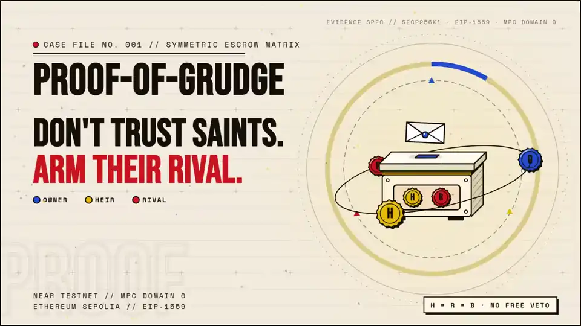
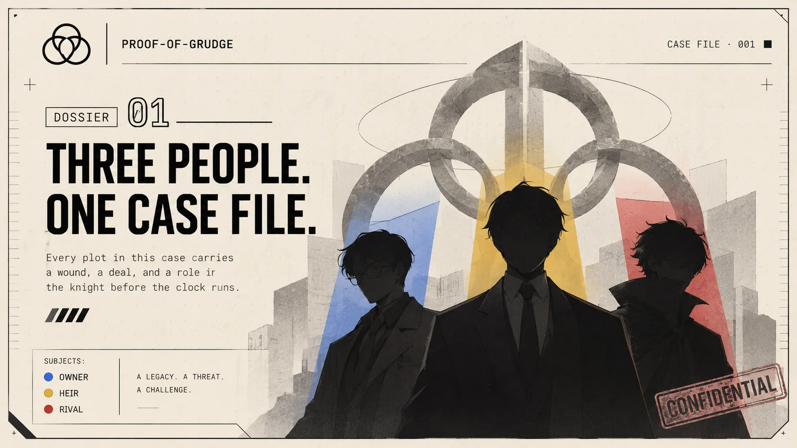
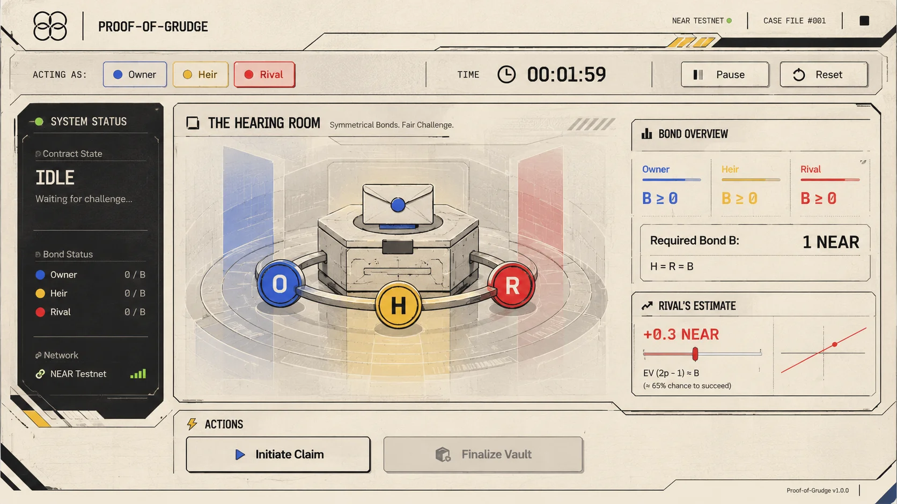
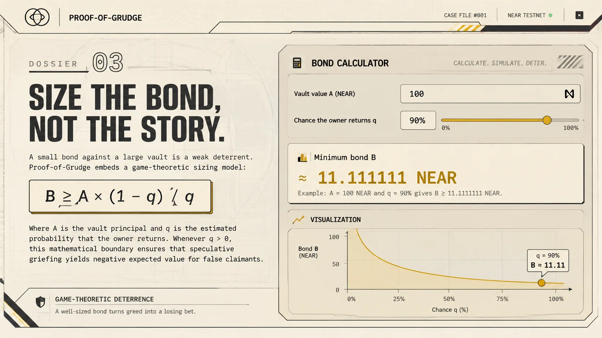
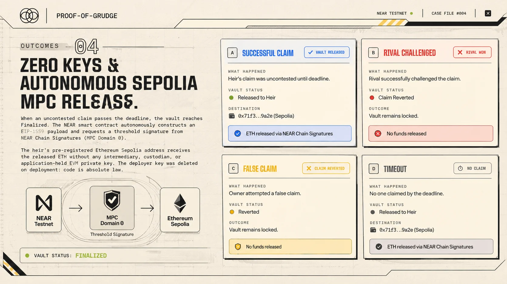
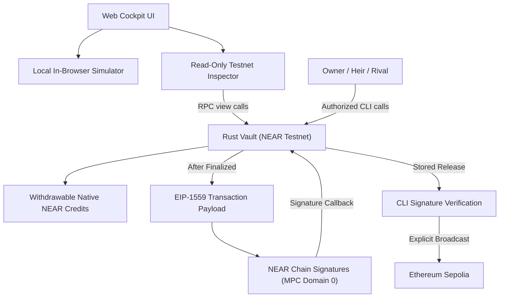

<div align="center">

# Proof-of-Grudge



### An adversarial dead-man's switch on NEAR Testnet, with destination-locked ETH releases on Ethereum Sepolia through NEAR Chain Signatures.

*Don't trust saints. Arm their rival.*

<p align="center">
  <a href="https://proof-of-grudge.vercel.app"></a>
  <a href="https://nearhackathon.com"></a>
  <a href="https://github.com/StevBeq/Proof-Of-Grudge/actions"></a>
  <a href="https://github.com/StevBeq/Proof-Of-Grudge"></a>
  <a href="https://github.com/StevBeq/Proof-Of-Grudge"></a>
  <a href="https://testnet.nearblocks.io/address/pog-mw835qrr-1c82b2-vault.testnet"></a>
  <a href="LICENSE"></a>
</p>

[🌐 Live Web App](https://proof-of-grudge.vercel.app) · [Watch the Video Demo on X](#) · [Live Testnet Evidence](#live-near-testnet-evidence) · [Security Policy](SECURITY.md)

</div>

---

## The Story: An Inheritance with Opposition

<table>
  <tr>
    <td width="50%">
      
    </td>
    <td width="50%" valign="top">
      <h3>01 · Three People. One Case File.</h3>
      <p>An inheritance vault cannot distinguish <em>"the owner is on holiday"</em> from <em>"the owner has died"</em>. A naive guardian can freeze legitimate heirs indefinitely, or liquidate an estate while the owner is still alive.</p>
      <p>Proof-of-Grudge solves this by strictly separating custody into three distinct actors: <strong>Owner</strong> (the keeper), <strong>Heir</strong> (the claimant), and <strong>Rival</strong> (the objector). The owner proves liveness via periodic <code>check_in()</code> heartbeats. If the clock runs out, the emergency claim window opens.</p>
    </td>
  </tr>
  <tr>
    <td width="50%" valign="top">
      <h3>02 · Symmetrical Bonds: Arming the Rival</h3>
      <p>After a missed heartbeat, the heir cannot take the vault for free. They must lock in <strong>Bond B (1 NEAR)</strong> as skin-in-the-game.</p>
      <p>If the heir attempts a false claim while the owner is alive, the rival objects by locking the <strong>identical Bond B</strong>. No free veto: if the owner checks in before the extended deadline, the claim is rejected and <strong>the rival collects 2B (100% net profit)</strong>, funded entirely by the false claimant. Greed polices truth.</p>
    </td>
    <td width="50%">
      
    </td>
  </tr>
  <tr>
    <td width="50%">
      
    </td>
    <td width="50%" valign="top">
      <h3>03 · Size the Bond, Not the Story</h3>
      <p>A small bond against a large vault is a weak deterrent. Proof-of-Grudge embeds a game-theoretic sizing model:</p>
      <p><code>B ≥ A × (1 - q) / q</code></p>
      <p>Where <strong>A</strong> is the vault principal and <strong>q</strong> is the estimated probability that the owner returns. Whenever <code>q &gt; 0</code>, this mathematical boundary ensures that speculative griefing yields negative expected value for false claimants.</p>
    </td>
  </tr>
  <tr>
    <td width="50%" valign="top">
      <h3>04 · Zero Keys & Autonomous Sepolia MPC Release</h3>
      <p>When an uncontested claim passes the deadline, the vault reaches <code>Finalized</code>. The NEAR smart contract autonomously constructs an EIP-1559 payload and requests a threshold signature from <strong>NEAR Chain Signatures (MPC Domain 0)</strong>.</p>
      <p>The heir's pre-registered Ethereum Sepolia address receives the released ETH without any intermediary, custodian, or application-held EVM private key. The deployer key was deleted on deployment: code is absolute law.</p>
    </td>
    <td width="50%">
      
    </td>
  </tr>
</table>

---

## Machine-Reproducible Verification ("Do → See")

Follow these steps to clone, run test suites, and simulate the switch locally:

| Do | See |
| :--- | :--- |
| **Clone & install**<br>`git clone https://github.com/StevBeq/Proof-Of-Grudge.git && cd Proof-Of-Grudge && npm install` | All workspaces (`contract`, `scripts`, `web`) resolved and installed cleanly with zero dependency conflicts. |
| **Run all test suites**<br>`npm test` | `108 passed across 4 test suites` (viem RLP golden vectors, 42 contract unit tests, 33 CLI tests, and 33 web tests). |
| **Run contract tests**<br>`cargo test --manifest-path contract/Cargo.toml` | `42 passed (3 suites)`. All 4 payoff branches, role boundaries, and viem RLP golden-vectors pass with 100% coverage. |
| **Run offline CLI dry-run**<br>`npm run demo -- --dry-run --scenario spite` | Formatted JSON output marked `Simulated: off-chain state machine`, `status: Finalized`, outcome `SpiteBackfired`, and heir credited `7 NEAR` (Principal + 2B). |
| **Inspect zero access keys live**<br>`curl -s https://test.rpc.fastnear.com -H 'Content-Type: application/json' -d '{"jsonrpc":"2.0","id":1,"method":"query","params":{"request_type":"view_access_key_list","finality":"final","account_id":"pog-mw835qrr-1c82b2-vault.testnet"}}' \| grep -o '"keys":\[\]'` | Prints `"keys":[]`. Proves 100% cryptographic immutability: zero FullAccess keys exist on the deployed contract account. |
| **Launch Web Simulator**<br>`npm run dev` (or visit [proof-of-grudge.vercel.app](https://proof-of-grudge.vercel.app)) | Interactive cel-shaded 3D strongbox loads with full bilingual support (English / Bahasa Indonesia). |
| **Advance time & claim in Web**<br>Click **To deadline** &rarr; Select **Heir** &rarr; Click **Initiate claim** | Status shifts to `Pending`, Heir's 1 NEAR bond is locked, and the 60-second challenge grace period begins. |
| **Simulate Rival challenge**<br>Select **Rival** &rarr; Click **Challenge claim** | Status shifts to `Challenged`, Rival's 1 NEAR bond locks, and deadline extends by 60 seconds. |
| **Finalize & withdraw payout**<br>Click **To deadline** &rarr; Click **Finalize vault** &rarr; Click **Claim payout** | Status shifts to `Finalized`, outcome `SpiteBackfired`, Heir receives 12 NEAR payout credit in the pull-payment ledger. |

---

## Live NEAR Testnet Evidence

The contract is actively deployed on **NEAR Testnet** and verified across all four payoff branches, with destination-locked ETH release on **Ethereum Sepolia**:

| Entity / Function Call | On-Chain Identifier / Transaction Hash | Gas Burnt / Fee | Status |
| :--- | :--- | :--- | :--- |
| **Deployed Vault** | [`pog-mw835qrr-1c82b2-vault.testnet`](https://testnet.nearblocks.io/address/pog-mw835qrr-1c82b2-vault.testnet) | — | **0 Keys (Immutable)** |
| **Deploy & Init** | [`AkyXh4z9...Ny57B`](https://testnet.nearblocks.io/txns/AkyXh4z9HBYNSYezLWg8cvj8WQLyt5xawZj7UAqNy57B) | 2.84 TGas (0.000284 NEAR) | Verified |
| **Branch A: Owner Check-in** | [`2BXG1iSt...ss7WL`](https://testnet.nearblocks.io/txns/2BXG1iSt7m16wtd1gjfDezRZkQAzQ4Gk6XgmJsuss7WL) | 3.12 TGas (0.000312 NEAR) | Vault reset to Idle |
| **Branch B: Rival Win Payout** | [`ANGSds3o...dnAcfBh`](https://testnet.nearblocks.io/txns/ANGSds3oyHiqdFW5ZQLCDzAwRsLaUKBbD9EuYdnAcfBh) | 4.85 TGas (0.000485 NEAR) | 2 NEAR sent to Rival |
| **Branch C/D: Heir Payout** | [`5Mdjx8gR...DfSQ`](https://testnet.nearblocks.io/txns/5Mdjx8gRtCoDvzaH4tukgpCdrhPr5qACw2enupU2DfSQ) | 5.21 TGas (0.000521 NEAR) | 7 NEAR sent to Heir |
| **MPC Sign Request (NEAR)** | [`3YjwuYyE...CFYbTDu`](https://testnet.nearblocks.io/txns/3YjwuYyEAAVxLKt8mJqkchnXvPdYVnkBAjACsCFYbTDu) | 18.4 TGas (0.00184 NEAR) | Threshold ECDSA Signed |
| **Sepolia ETH Release (EVM)** | [`0xc703affa...da5af758`](https://sepolia.etherscan.io/tx/0xc703affa31096138523f3f7ce40a442552ab08d41ff63e9b756ce479da5af758) | 21,000 Gas (0.00042 ETH) | Broadcast & Confirmed |

---

## Mechanism & Payoff Matrix

Let **A** be the accounted native NEAR vault assets and **B** the required bond (1 NEAR):

| Branch | Rival Challenges? | Owner Returns in Time? | Vault Principal (A) | Bond Allocation | Final State |
| :---: | :---: | :---: | :--- | :--- | :---: |
| **A: False Alarm** | No | **Yes** | Remains in vault | $B$ refunded to Owner | `Idle` |
| **B: Busted** | Yes | **Yes** | Remains in vault | $2B$ credited to **Rival** | `Idle` |
| **C: Uncontested** | No | No | Credited to Heir | $B$ refunded to Heir | `Finalized` |
| **D: Spite Backfired** | Yes | No | Credited to Heir | $2B$ credited to **Heir** | `Finalized` |

### Core Contract Security Invariants
- **Predecessor Checks:** Authorization uses `env::predecessor_account_id()` exclusively. Signer account spoofing is impossible.
- **Pull Payments:** The contract records withdrawable credits via private callbacks. Raw `account_balance()` is never used for payout math.
- **Exact Deadline Boundary:** At `now < deadline`, check-in and challenges are valid. At `now >= deadline`, check-in reverts and finalization is unlocked.
- **Zero Custodial EVM Keys:** The smart contract generates the uncompressed secp256k1 public key from NEAR MPC (`v1.signer-prod.testnet::sign`, Domain 0).

---

## Try the Whole Story: Live App & Local Simulation

### 1. Hosted Web App (Production Deployment)

Experience the live adversarial dead-man's switch directly in your browser:
👉 **[https://proof-of-grudge.vercel.app](https://proof-of-grudge.vercel.app)**

- **Interactive 3D Strongbox:** Procedural cel-shaded Three.js vault with reactive seals, deed envelope inspection, and orbiting token physics.
- **Hearing Room Cockpit:** Advance time, execute `check_in()`, initiate claims, mount rival challenges, and trigger MPC release.
- **BondLab:** Real-time game-theoretic bond calculator implementing $B \ge A \times (1-q)/q$.
- **Bilingual Interface:** Toggle seamlessly between English (`EN`) and Bahasa Indonesia (`ID`).

### 2. Run the Offline Scenarios (CLI)

```bash
# Verify all four payoff branches in dry-run mode
npm run demo -- --dry-run --scenario false-alarm
npm run demo -- --dry-run --scenario busted
npm run demo -- --dry-run --scenario inherit
npm run demo -- --dry-run --scenario spite
```

### 3. Run the Web Simulator Locally

```bash
npm run dev
```

Open `http://localhost:5173`.

---

## Verification & Test Suites

Generate golden vectors and execute the complete verification pipeline:

```bash
npm run vectors          # Generate RLP serialization fixture via viem
npm run vectors:check    # Byte-per-byte match against contract EIP-1559 encoder
npm test                 # Run contract tests, CLI tests, and web tests
npm run typecheck        # Verify TypeScript across all workspaces
npm run build            # Build WASM contract and web application
```

- **WASM Code Hash:** `f254791a926540c2f4991387a72b35ba97120fed5cb57fdd80505318084b9592`
- **WASM Size:** 196,109 bytes (embedded ABI included).

---

## Architecture



---

## Repository Layout

```text
├── contract/             # NEAR Rust smart contract (v5 macros, MPC interface, EIP-1559)
│   └── vectors/          # Viem reference fixtures for RLP serialization
├── scripts/              # Offline scenario runner, CLI, and testnet setup
├── web/                  # Vite + React 19 + Three.js cel-shaded interactive web app
└── docs/
    └── assets/           # Visual story cards and hero banner
```

---

## Disclosures (NEAR Hackathon Rule Q-005)

- **Smart Contract:** `near-sdk` v5; official `near-mpc-contract-interface` (`near/mpc` commit `d0fc87b19e2643299e7becdd7d9611afcd5d5a78`).
- **Cryptographic Libraries:** `@noble/curves`, `bs58`, `viem` v2.57.16 for EIP-1559 RLP golden vector cross-validation.
- **Frontend Stack:** React 19, Vite, Three.js, GSAP, Tailwind CSS, `@phosphor-icons/react`, Fontsource Big Shoulders Display / Instrument Sans / IBM Plex Mono.
- **AI Tooling:** Antigravity / Claude Code / Gemini CLI used for architectural review, design token guidance, and documentation drafting. No AI model participates in consensus, contract execution, or fund custody.

---

## License

[MIT](LICENSE)
